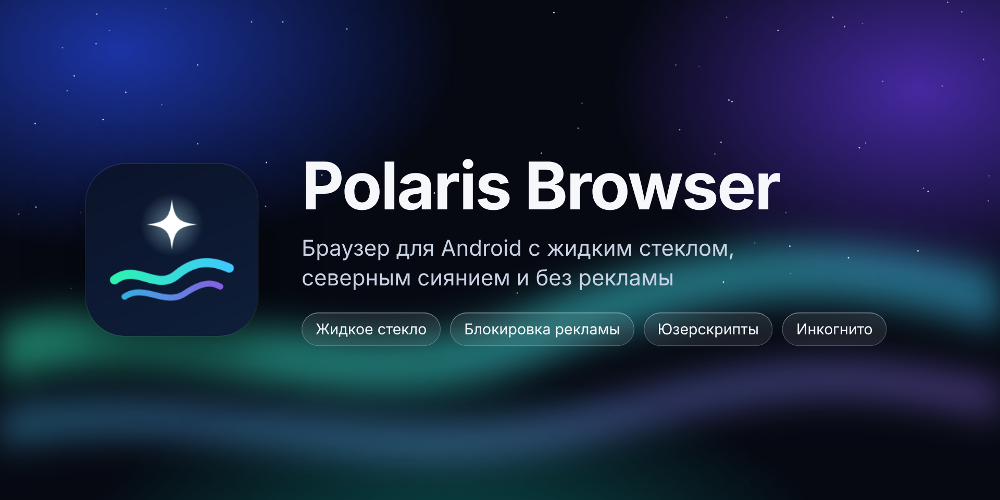
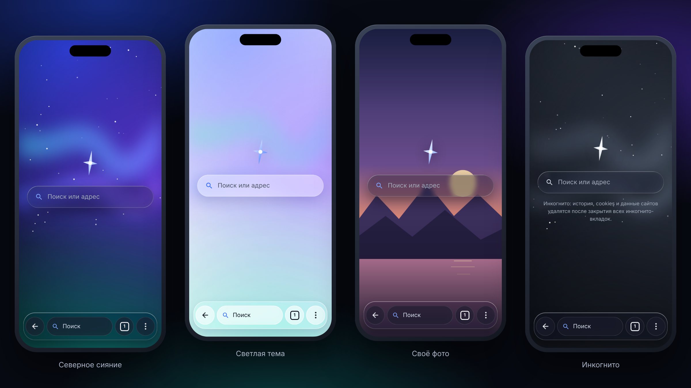

<p align="center">
  
</p>

<p align="center">
  <a href="https://github.com/Vikmat01/PolarisBrowser/releases/latest"></a>
  <a href="https://github.com/Vikmat01/PolarisBrowser/releases"></a>
  
  
</p>

<p align="center">
  <a href="https://github.com/Vikmat01/PolarisBrowser/releases/latest"><b>⬇ Скачать последнюю версию</b></a>
</p>

---

<p align="center">
  
</p>

## ✨ Возможности

| | |
|---|---|
| 🔮 **Жидкое стекло** | Нижняя панель и меню преломляют страницу под собой, блик следует за пальцем. Три режима: прозрачное, матовое, плотное |
| 🌌 **Живая главная** | Плывущее северное сияние и мерцающие звёзды или своё фото с медленным наплывом |
| 🎨 **Оформление** | Восемь цветов, светлая и тёмная тема, автоматически по восходу и закату |
| 🛡 **Без рекламы** | EasyList + RuAdList, скрытие пустых рекламных блоков, исключения для сайтов, блокировка всплывающих окон |
| 🕶 **Инкогнито** | Отдельный профиль, данные стираются при закрытии, скриншоты и запись экрана заблокированы |
| 🧩 **Расширения** | Юзерскрипты (совместимость с Tampermonkey) и стили (`.user.css`) с Greasy Fork и UserStyles.world |
| 📖 **Режим чтения** | Чистый текст статьи, размер шрифта, сепия и тёмная тема |
| 🎬 **Видео** | Скорость, жесты яркости и громкости, «картинка в картинке», свой плеер для mp4 / m3u8 |
| 🔄 **Автообновления** | Браузер сам находит новый релиз здесь и предлагает установить |

## 📲 Установка

1. Скачайте `PolarisBrowser-x.y.apk` из [последнего релиза](https://github.com/Vikmat01/PolarisBrowser/releases/latest).
2. Разрешите установку из браузера или файлового менеджера, если Android спросит.
3. Дальше обновления приходят сами (Настройки → «О приложении»).

Нужен Android 10 или новее. Стекло-линза работает на Android 13+, на более старых версиях панель матовая.

## 🛠 Сборка

```bash
./gradlew assembleRelease
```

Без `keystore.properties` релиз подписывается отладочным ключом. Для своей подписи положите в корень проекта `keystore.properties`:

```properties
storeFile=polaris.jks
storePassword=…
keyAlias=…
keyPassword=…
```

## 🚀 Выпуск новой версии

1. Поднять `versionCode` и `versionName` в `app/build.gradle.kts`.
2. Описать изменения в `release-notes/vX.Y.md` и закоммитить в `main`.
3. GitHub Actions соберёт подписанный APK и опубликует релиз, браузеры сами предложат обновиться.

Секреты репозитория для подписи: `KEYSTORE_BASE64`, `KEYSTORE_PASSWORD`, `KEY_ALIAS`, `KEY_PASSWORD`.

## 📄 Благодарности

Режим чтения использует [Readability.js](https://github.com/mozilla/readability) от Mozilla (Apache-2.0).
